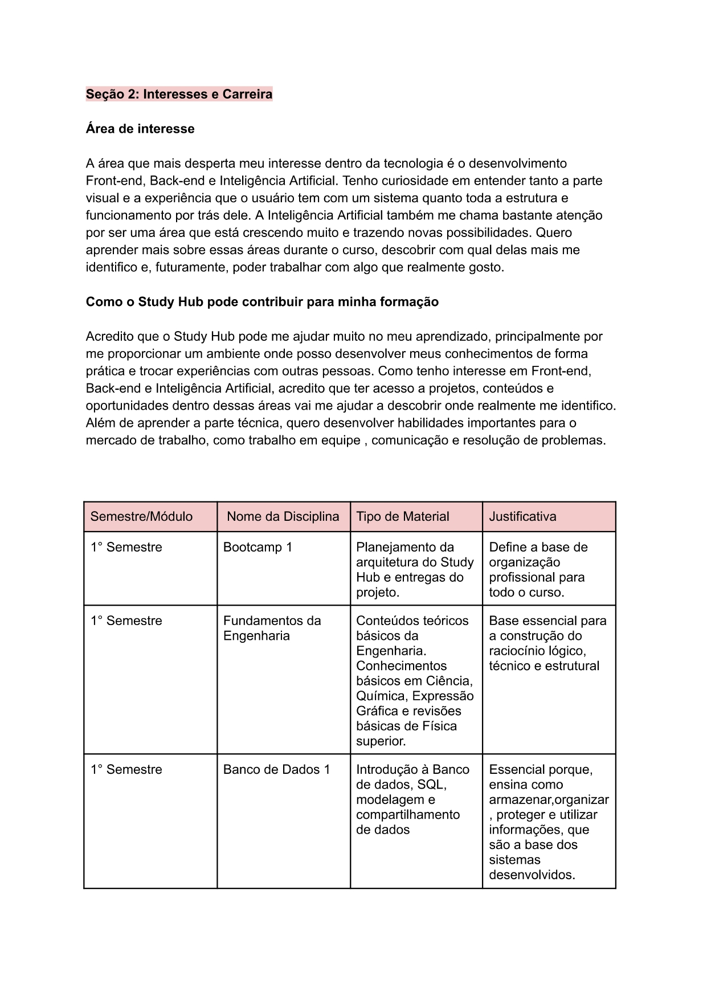
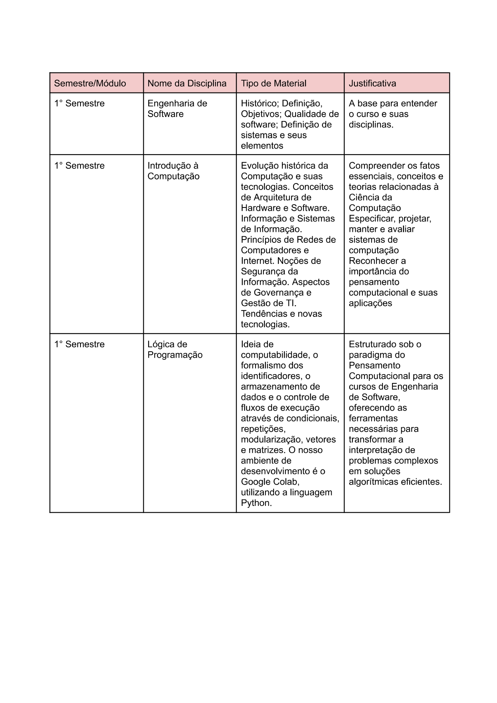

# github_Page

Minha página de portfólio apresenta um pouco sobre mim, minha trajetória acadêmica e o curso de Engenharia de Software. Nela, compartilho os conhecimentos que venho adquirindo ao longo da graduação, as atividades realizadas e os projetos desenvolvidos, mostrando minha evolução e meu aprendizado na área de tecnologia.

